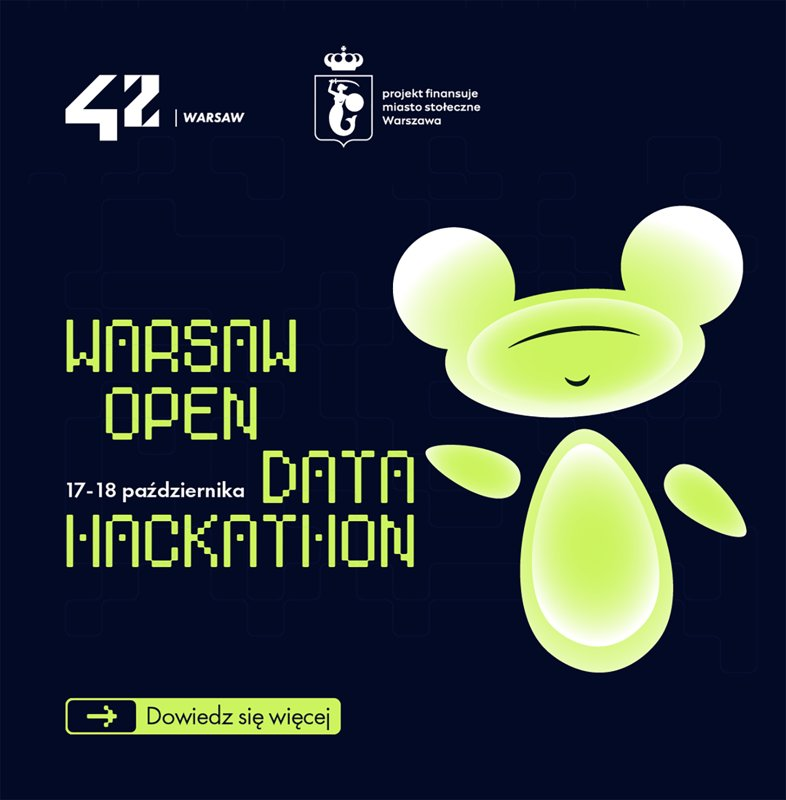

<p align="center">
  
  &nbsp;&nbsp;&nbsp;
  
</p>

# ProwadźMnie

Nawigator pieszy dla osób starszych. Patrzysz przez aparat telefonu, a aplikacja pokazuje, w którą stronę iść. Możesz też zapytać głosem, a ona odpowie prostymi słowami.

Projekt powstał na [Warsaw Open Data Hackathon 2026](https://um.warszawa.pl/-/warsaw-open-data-hackathon-2026) (17–18 października 2026, 42 Warsaw, projekt finansowany przez m.st. Warszawa). Korzysta z otwartych danych miasta: [Kalendarza wydarzeń m.st. Warszawy](https://dane.um.warszawa.pl/pl/catalogue/ba202e4b-dfa9-440c-83c0-0b3517520cb8).

## Co robi

- Pokazuje na obrazie z aparatu duży znak celu, odległość i strzałkę: „Idź prosto”, „Skręć w prawo”, „Odwróć się”.
- Ma główny przycisk na dole: **Przytrzymaj i mów**. Trzymasz, mówisz, puszczasz.
- Odpowiada po polsku, krótko i spokojnie, jeden krok naraz. Przypomina o ostrożności przy przejściach.
- Pomaga dojść w nowe miejsce, np. „Zaprowadź mnie do apteki”, i pamięta, na którym etapie drogi jesteś.
- Podpowiada wydarzenia z miejskiego kalendarza Warszawy, dobrane do możliwości osoby starszej: blisko, krótko i spokojnie.
- Czyta na głos nowe powiadomienia, np. zaproszenia od bliskich. Nie przerywa trwającej rozmowy.
- Ma przycisk **SOS / Pomoc**, dostępny zawsze, także przed zgodą na aparat i GPS.
- Duże litery i mocny kontrast.

## Jak używać

1. Otwórz aplikację i naciśnij **Zaczynamy**. Zgódź się na aparat i lokalizację.
2. Wyjdź na zewnątrz i trzymaj telefon przed sobą.
3. Idź za strzałką. Gdy masz pytanie, przytrzymaj żółty przycisk i mów.

## Wydarzenia z Kalendarza Warszawy

Na pytanie „Co ciekawego dzieje się w okolicy?” asystent sięga do [Kalendarza wydarzeń m.st. Warszawy](https://dane.um.warszawa.pl/pl/catalogue/ba202e4b-dfa9-440c-83c0-0b3517520cb8) z portalu otwartych danych miasta.

- Pomija zakończone terminy. Dla wydarzeń cyklicznych bierze najbliższy aktualny termin.
- Domyślnie szuka w najbliższym tygodniu i sortuje według odległości. Można też zapytać o frazę, dzielnicę lub konkretny termin.
- Asystent proponuje jedno, najwyżej dwa wydarzenia. Wybiera spokojne i bliskie, z miejscami siedzącymi, a gdy opisowi brakuje ważnych informacji, mówi, co trzeba sprawdzić.
- Do API miasta nie trafia położenie użytkownika. Odległość liczy telefon.

## Pomoc

Naciśnięcie **SOS / Pomoc** od razu przerywa rozmowę, rozpoznawanie mowy, czytanie powiadomień i nawigację. Zapisane drogi pozostają w pamięci i wznawiają się dopiero na wyraźną prośbę.

Ekran pomocy ma trzy przyciski:

- **Zadzwoń**: kontakt do bliskiej osoby, pogotowie (999) i numer alarmowy (112). Wybranie kontaktu otwiera aplikację Telefon z gotowym numerem; połączenie zatwierdza sam użytkownik. Numery służb: [Pacjent.gov.pl](https://pacjent.gov.pl/pogotowie-i-numer-alarmowy).
- **Opisz / opowiedz**: wpisanie albo podyktowanie, co się stało. Opis widać przy wyborze kontaktu, żeby łatwo było go przeczytać przez telefon. Nie jest nigdzie wysyłany.
- **Pomyłka**: zamyka pomoc bez dzwonienia i bez wznawiania nawigacji.

Pomoc działa bez internetu, poza dyktowaniem.

## Twoje dane

Aplikacja nie ma zewnętrznej bazy danych. Wszystko zostaje w telefonie i znika po zamknięciu aplikacji. Do internetu trafia tylko to, co potrzebne do odpowiedzi:

- pytanie i zdjęcie z aparatu (asystent AI przez OpenRouter); zdjęcie nie jest zapamiętywane w historii rozmowy,
- cel i położenie przy szukaniu drogi (Google Places i Google Routes),
- rozpoznawanie mowy (usługa Google w telefonie),
- zapytanie do Kalendarza wydarzeń Warszawy, bez położenia użytkownika.

## Dla programistów

Aplikacja na Androida (Google Pixel 6a) w Expo i React Native. Asystent działa na modelu Gemini 3.1 Flash-Lite przez OpenRouter i Vercel AI SDK.

```sh
bun install
cp .env.example .env   # wpisz klucze API
bun run start
```

Zmienne w `.env`:

- `EXPO_PUBLIC_OPENROUTER_API_KEY`: rozmowa z asystentem,
- `EXPO_PUBLIC_GOOGLE_MAPS_API_KEY`: miejsca i trasy; włącz **Places API (New)**, **Routes API** i billing w Google Cloud,
- `EXPO_PUBLIC_WARSAW_API_TOKEN`: JWT z [portalu danych Warszawy](https://dane.um.warszawa.pl).

Nie umieszczaj kluczy w repozytorium. Po zmianie `.env` zrestartuj Metro.

Potrzebny jest zainstalowany build deweloperski (nie Expo Go). Nowy build Androida uruchamiaj tylko na wyraźną prośbę, bo limity EAS są małe. Szczegóły w `AGENTS.md`.

### Narzędzia asystenta

- `navigation`: wyszukuje miejsca i pobiera trasę pieszą z instrukcjami i geometrią. Trasa jest pamiętana przez całą rozmowę, także po przerwie. Kolejny odcinek wymaga prośby użytkownika i GPS w pobliżu końca bieżącego odcinka.
- `warsaw_events`: `POST https://dane.um.warszawa.pl/api/action/get_bmm_kalendarz_wydarzen` z surowym JWT w nagłówku `Authorization` (bez prefiksu Bearer). Dokumentacja: [parametry](https://dane.um.warszawa.pl/files/bmm_kalendarz_wydarzen_pa.json), [przykład](https://dane.um.warszawa.pl/files/bmm_kalendarz_wydarzen_pw.json). Kalendarz jest pobierany dopiero przy wywołaniu narzędzia i trzymany w pamięci przez 10 minut. Do modelu trafia do dziesięciu wyników z krótkim opisem, bez klucza API.
- `drop_photo`: model woła je, gdy zdjęcie nie ma związku z pytaniem; kolejne kroki narzędzi idą już bez zdjęcia.

### Sprawdzanie

```sh
bun run check
bun run typecheck
bun test
```

Formatowanie i porządkowanie importów: `bun run format` (Biome). Lokalne importy, również dynamiczne, używają aliasu `@/`, np. `@/src/assistant`. Biome odrzuca importy względne.

Układ kamery sprawdza `bun test src/cameraLayout.test.ts`: rzeczywisty JSX `CameraSession` jest układany w Yoga w osobnym procesie, z atrapami sprzętu.
